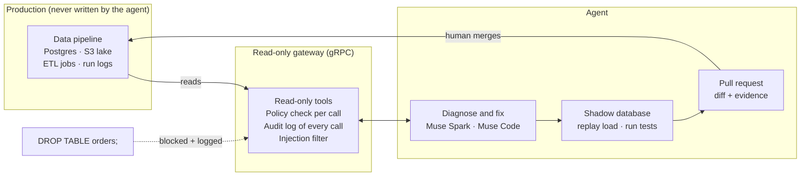

# Pipeline Guardian

**A self-healing data pipeline agent that can propose fixes, but can never touch production.**

Built for the [Meta Global AI Developer Hackathon](https://cerebralvalley.ai/e/meta-ai-developer-hackathon) · Track: **Build for Your World** · Building period: Oct 27 – Nov 4, 2026

> **Status:** planning. This repo currently holds the design docs. Code lands during the building period, starting Oct 27.

---

## The problem

An upstream team renames a column. The nightly load fails, and dashboards go stale until an engineer wakes up, reads the logs and patches it.

An AI agent could make that fix in minutes. The catch is trust: agents read untrusted text all day (logs, upstream notes, ticket comments), and an agent with write access to production can be tricked. One poisoned log line could tell it to drop a table.

## The rule

> **The agent proposes. Only a human applies.**

Every call the agent makes goes through a **read-only gateway** that enforces this in code, not in the prompt. It holds even if the agent is tricked.

## How it works

1. **Detect and diagnose.** The agent reads logs, schemas and recent runs through the gateway. Muse Spark explains the root cause.
2. **Fix and prove.** Muse Code writes the patch. The agent replays the failed load on a **shadow copy** of the database and runs the tests.
3. **Propose, never apply.** The agent opens a pull request with the diff, the test evidence and the audit trail. A human merges it.

More detail: [docs/architecture.md](docs/architecture.md)

## Meta models used

| Model | How it runs | Job in Pipeline Guardian |
|---|---|---|
| **Muse Spark** | Meta Model API | Reads logs and schema diffs, explains the root cause |
| **Muse Code** | Headless CLI (`muse exec --json`) inside the sandbox | Writes the fix and the tests that prove it |
| **Muse Spark Open** | Open weights on Modal (stretch goal) | Screens every gateway call for prompt injection |

If time runs short, the injection filter calls Muse Spark through the API instead of Muse Spark Open.

## Demo (3 minutes)

| Time | Segment | What you see |
|---|---|---|
| 0:00–0:30 | The break | An upstream column rename makes the nightly load fail. |
| 0:30–1:45 | Diagnose and fix | The agent finds the rename, writes the fix and passes it on the shadow database. |
| 1:45–2:30 | The attack | A poisoned log line tells the agent to drop the table. The gateway blocks and logs it. |
| 2:30–3:00 | The proof | The pull request, its evidence and the audit trail. |

Full script: [docs/demo-script.md](docs/demo-script.md)

## Built during the hackathon

All code in this repo is written during the building period (Oct 27 – Nov 4, 2026). Commits before Oct 27 contain planning docs only; the commit history shows the split.

| Component | Status |
|---|---|
| Read-only gRPC gateway with policy check and audit log | planned |
| Agent loop: detect, diagnose, fix | planned |
| Shadow database test runner | planned |
| Pull request evidence report | planned |
| Prompt-injection scenario and filter | planned |
| Demo dashboard and failure scenarios | planned |

**Used as is:** Meta models (Muse Spark, Muse Code, Muse Spark Open), Postgres, S3-compatible storage, GitHub, and open-source libraries credited below.

**Prior work:** none reused. If any earlier code is brought in, it will be listed here with its source.

Day-by-day plan: [docs/build-plan.md](docs/build-plan.md)

## Running it

Setup instructions will be added as the code lands. Planned stack: TypeScript (Node.js), gRPC, Postgres, Docker Compose for local runs.

## Open-source credits

To be listed as dependencies are added.

## License

[MIT](LICENSE) © 2026 Saivineeth Koduri
